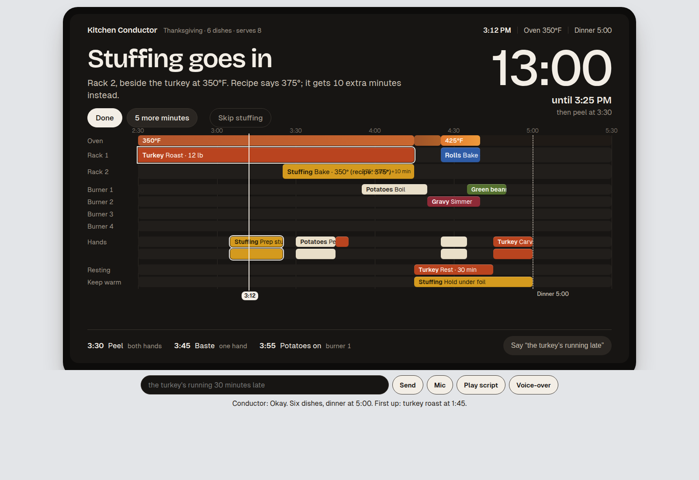

# Kitchen Conductor

Kitchen Conductor turns the dishes and a serve time into one cooking timeline. One oven runs at one temperature, four burners and two hands stay in the plan, and the evening re-plans when something runs late. A pasted recipe is read once. The schedule itself is ordinary code.



## Requirements

Node 24 LTS or newer, and npm. Tested on Node 24.22.1 and 26.12.1.

## Quick start

```bash
npm i
cp .env.example .env
npm run dev
```

Open http://127.0.0.1:8787. One process serves the simulator and the MCP server. Meals stay in memory, so a restart clears them. Put the demo meal back with:

```bash
npx tsx scripts/seed-demo.ts
```

Play script speaks the cook's lines in the browser. The narration is at http://127.0.0.1:8787/voiceover. Press D for the demo clock.

## Project layout

`packages/scheduler` places the meal. `packages/recipes` is the dish library and the one recipe parse. `packages/core` is the shared meal model. `apps/server` is the MCP server. `apps/card` draws the timeline. `apps/sim` is the browser.

## How it works

The scheduler places the meal backward from the time you eat. The oven holds one temperature at a time. A step that can share that temperature, within 50°F, does, and its minutes are adjusted onto a five-minute grid. Preheat and temperature changes stay empty. Burners and hands are placed around that.

The MCP server speaks protocol 2026-07-28 over Streamable HTTP at `/mcp`: stateless, with no `initialize` handshake, and `server/discover` for version selection. Clients on 2025-11-25 are still served through the SDK's stateless fallback. The timeline is the resource `ui://kitchen-conductor/timeline.html`. The simulator is an MCP client: a chip or a spoken line becomes `tools/call`.

Dishes in the library are scheduled with no model call. A recipe that is not in the library goes through one [Amazon Bedrock](https://docs.aws.amazon.com/bedrock/) Converse call to `us.anthropic.claude-haiku-4-5-20251001-v1:0` in `us-east-1`. The reply is checked in code and kept. It is never sent back to a model. Phrases are routed by a grammar.

The browser recognizes speech, speaks the replies, and speaks the voice-over.

## Tests

```bash
KC_BEDROCK=stub npm test
```

`KC_BEDROCK=stub` is the default in `.env.example`. A live parse, on a computer that already has AWS credentials:

```bash
AWS_REGION=us-east-1 KC_BEDROCK=live npx tsx scripts/warm-bedrock.ts
```

## License

MIT. See [LICENSE](LICENSE).
